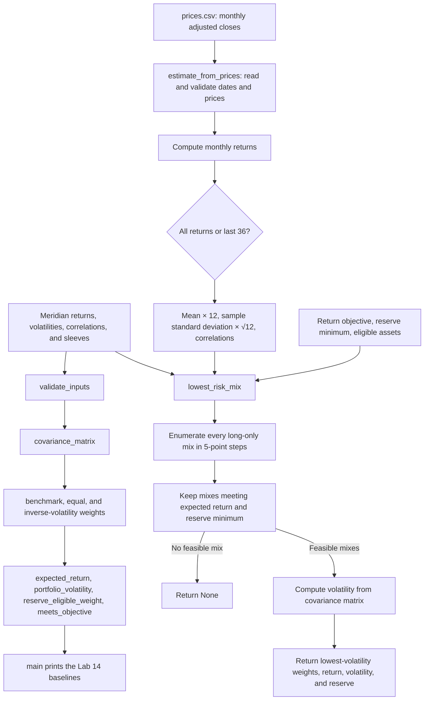

# Lab 15 — Portfolio stability decision

Run `./.venv/Scripts/python.exe portfolio.py` for the unchanged Lab 14 baselines. Run `./.venv/Scripts/python.exe -m streamlit run app.py` and upload `prices.csv` for this lab. The app uses `portfolio.py` for its search and estimates; it has no separate portfolio calculations.

## Decision question and mandate

**Question:** Which long-only mix carries the least volatility while meeting the objective and reserve rule, and how stable is it when an estimate changes?

The current [Lab 13 mandate](mandate.md.md) is Meridian rather than a separate Project 2 mandate. I therefore use its stated return objective as the numeric proxy: CPI estimated at 2.5% plus 4% = **6.5% expected annual return**. The hard constraint tested here is **at least 3% in reserve-eligible assets**, derived from four quarterly $0.75 million payments against a $100 million reserve. BIL and IEF count as the reserve assets in this fund universe. The search also enforces long-only weights summing to 100%, in 5-point steps. This nominal historical estimate does not verify Meridian's CPI + 4% net-of-costs outcome over rolling five-year periods. Other Meridian rules, including issuer concentration, turnover, five-day redemption, and S9's unclear loss condition, require separate review before adoption.

## Fund universe and price provenance

These four funds follow the roles in the Lab 14 preparation table, with SPY as a broad U.S. equity index fund rather than the example global fund VT. Fund roles are verified from issuer pages. The price observations for every ticker come from the same [pinned adjusted-close snapshot](https://github.com/manisahni/marketdata/blob/65a079329e379e104495f459e12e76a8f995585a/daily_adjclose_wide.csv), whose [README](https://github.com/manisahni/marketdata/blob/65a079329e379e104495f459e12e76a8f995585a/README.md) describes the data as dividend/split-adjusted daily closes originally downloaded with yfinance. **Downloaded 2026-10-22.** Direct Yahoo Finance download returned HTTP 429, so this is an attributed secondary snapshot, not a fresh Yahoo download. The snapshot ends in August 2026; the analysis uses completed months through July 2026.

| Ticker | Fund and role | Price source | Download date |
|---|---|---|---|
| BIL | [State Street SPDR Bloomberg 1-3 Month T-Bill ETF](https://www.ssga.com/us/en/individual/etfs/state-street-spdr-bloomberg-1-3-month-t-bill-etf-bil) — cash/reserve | Pinned adjusted-close snapshot above | 2026-10-22 |
| IEF | [iShares 7-10 Year Treasury Bond ETF](https://www.ishares.com/us/products/239456/ishares-7-10-year-treasury-bond-etf) — government bonds/reserve | Same snapshot | 2026-10-22 |
| LQD | [iShares iBoxx $ Investment Grade Corporate Bond ETF](https://www.ishares.com/us/products/239566/lqd-ishares-iboxx-investment-grade-corporate-bond-etf) — investment-grade fixed income | Same snapshot | 2026-10-22 |
| SPY | [State Street SPDR S&P 500 ETF Trust](https://www.ssga.com/us/en/individual/etfs/state-street-spdr-sp-500-etf-trust-spy) — broad U.S. equity | Same snapshot | 2026-10-22 |

`build_prices.py` chooses the final trading day of each month from July 2021 through July 2026. The resulting `prices.csv` has 61 consecutive monthly adjusted closes and yields 60 monthly returns. Its pinned source file SHA-256 is `8d89c10589cf7507a6ce59c6cb93510c7c9a53726fac64d277f863fba3575940`. The most recent 36 returns cover August 2023 through July 2026. Historical means are **estimates, not forecasts**. The CSV is current only through July 2026.

## Engine flow

The top path is the original `python portfolio.py` output. The CSV path estimates the inputs for the app. Both input sources can feed `lowest_risk_mix`. In the search function, the combination loop generates each 5-point allocation once. `expected_return` rejects mixes below the objective, and `reserve_eligible_weight` rejects mixes below the reserve minimum. `portfolio_volatility` evaluates each remaining mix using the covariance matrix; the function keeps the mix with the smallest volatility and returns `None` if none qualifies.

## Meridian checks

| Inputs | Bills / 10-year / IG / equity | Return | Volatility | Largest weight change from loaded |
|---|---:|---:|---:|---:|
| As loaded | 0 / 20 / 25 / 55 | 6.51% | 9.44% | 0 points |
| Equity return estimate 8.0% → 7.0% | 0 / 10 / 10 / 80 | 6.53% | 12.94% | 25 points |
| IG–equity correlation 0.25 → 0.50 in both cells | 0 / 40 / 0 / 60 | 6.52% | 9.73% | 25 points |

The correlation probe was run with temporary inputs passed to the engine, then discarded. The two cells in `portfolio.py` remain at 0.25. Running `portfolio.py` still prints the three original Lab 14 baseline lines unchanged. The app's equity-return control produces the 25-point Meridian change.

## My fund universe: results

Returns and volatilities below are annualized **estimates** from `prices.csv`. Reserve-eligible assets are BIL and IEF; the objective is 6.5% and reserve minimum is 3% in both runs.

| Sample | BIL / IEF / LQD / SPY weights | Return estimate | Volatility estimate | Reserve-eligible weight |
|---|---:|---:|---:|---:|
| All 60 monthly returns | 65 / 0 / 0 / 35 | 6.92% | 5.63% | 65% |
| Last 36 monthly returns | 85 / 0 / 0 / 15 | 6.58% | 1.99% | 85% |

The largest weight change between sample windows is **20 points**, in both BIL and SPY. The 36-month sample estimates SPY's annual return at 18.51%, versus 13.30% from all 60 returns. That higher recent equity return lets the search meet 6.5% with only 15% SPY. This is estimation risk: the optimizer treats noisy historical averages as exact inputs, so a small change can change which grid mix first clears the return threshold and can move a large allocation.

Neither sample selects IEF or LQD: under these particular historical estimates and the 5-point grid, the lower-volatility feasible mix uses BIL for the defensive weight and SPY for the return target. This result is a property of the estimates and search, not a claim that the excluded funds are unsuitable in general.

## One-point estimate stress and fresh eyes

As a self-directed stress, I lowered the all-month SPY return estimate by one percentage point, from 13.30% to 12.30%, while leaving volatility and correlations as loaded. The mix stayed **65 / 0 / 0 / 35**; its expected return estimate fell from **6.92% to 6.57%**, volatility remained **5.63%**, and the largest weight change was **0 points**. The mix still clears 6.5%, but by only about 0.07 percentage points. This stress shows local stability to that specific one-point revision; the 20-point sample-window change shows that the answer is sensitive to how returns are estimated.

**Partner attack:** Pending an actual partner's use of the app. Record the estimate they change, the new mix and return/volatility, then write two sentences answering why the result did or did not move. Do not substitute the self-directed stress above for a partner observation.

## Call and reflection

**Provisional call: pilot.** The all-month mix meets the coded objective and reserve rule, but switching to the last 36 returns moves 20 points between BIL and SPY. I would consider adoption only after the CIO clarifies S9's acceptable loss measure and we check the remaining mandate rules and the return estimates with data through the current month.

The lowest-risk mix moved because the recent sample raised the estimated equity return, so less equity was needed to meet the same objective. Before adopting it, I would want a clear loss limit, a check of all mandate constraints, updated data, and evidence that the allocation remains sensible under return estimates beyond this one historical window.
